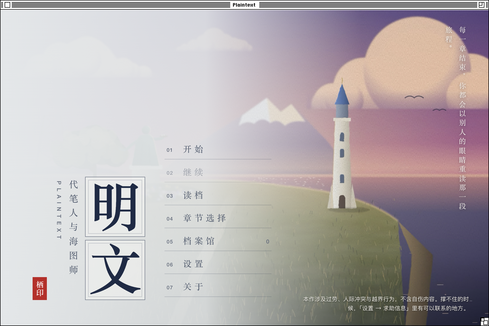
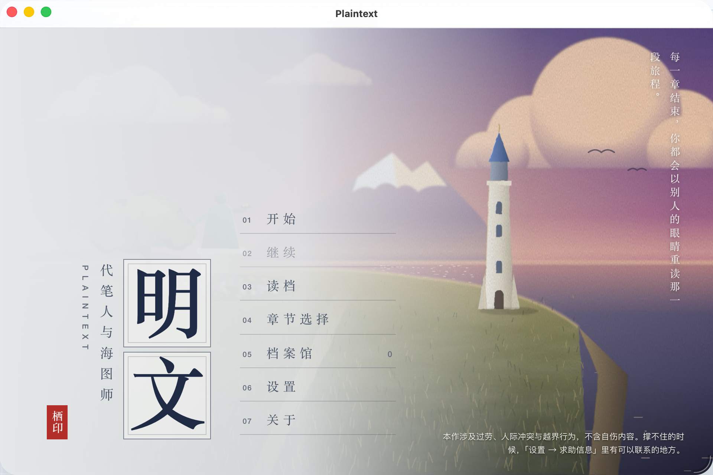

# 明文 Plaintext

A visual novel that runs in a browser: a letter-writer and a chart-maker, and
the difference between saying a thing plainly and passing it on. The text is
in Simplified Chinese. It is a work of fiction.

## Screenshots

Captured running inside the AI System 6 desk: Classic on the left, Liquid Glass on the right.

<p> </p>

## Play

Any static file server will do; nothing is installed and nothing is fetched
from elsewhere.

```bash
npm start
```

Then open `http://localhost:8080/`. Saves stay in the browser's local storage.

Keys: Space or Enter to advance, number keys to choose, Esc for the menu,
A auto, S skip, L log.

## Build

```bash
npm run build
```

`tools/build_dist.sh` copies the runtime into `dist/` and removes comments
from the scripts and the stylesheet. It needs `bash` and Node; there are no
dependencies. Tagged versions are built from this command.

## Layout

| Path | What it is |
| --- | --- |
| `index.html`, `style.css` | The page |
| `engine.js`, `rules.js` | Reader, saves, menus, the rules that decide an ending |
| `story/` | The script: ten chapters, the endings, the hidden scenes |
| `art.js`, `portrait2.js`, `img/` | Drawn backgrounds and the portraits |
| `audio.js` | Music and effects, synthesised in the browser |
| `ais6-bridge.js`, `desk.js`, `app.manifest.json` | Lets a host page embed the novel in a frame and keep its saves; on its own page the same calls fall back to local storage |

## Credits and content notes

See [NOTICE](NOTICE). The novel touches on overwork, conflict between people,
control and overstepping; it contains no self-harm.

## Licence

The code is under the MIT License. The script (`story/`) and the pictures
(`img/`) are all rights reserved: read them and play, but do not reuse them.
The full terms are in [LICENSE](LICENSE).

中文说明见 [README.zh-CN.md](README.zh-CN.md)。
