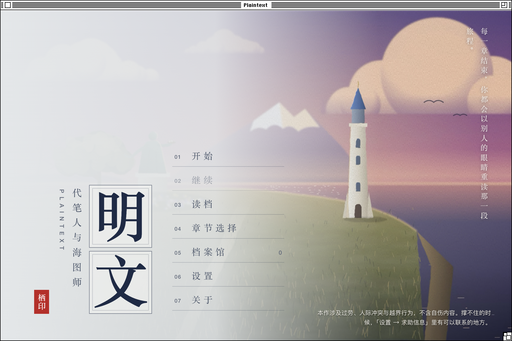
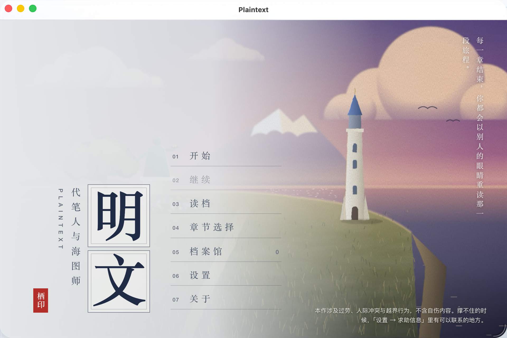

# 明文 Plaintext

一部在浏览器里运行的视觉小说：代笔人与海图师，讲的是直说与传话的差别。正文为简体中文。本作纯属虚构。

## 截图

在 AI System 6 桌面里实际运行时截取，左为 Classic，右为 Liquid Glass。

<p> </p>

## 游玩

任何静态文件服务器都可以；不需要安装，也不从别处加载东西。

```bash
npm start
```

然后打开 `http://localhost:8080/`。存档留在浏览器的本地存储里。

按键：空格或回车推进，数字键选择，Esc 菜单，A 自动，S 快进，L 日志。

## 构建

```bash
npm run build
```

`tools/build_dist.sh` 把运行时文件复制到 `dist/`，并去掉脚本和样式表里的注释。只需要 `bash` 和 Node，没有依赖。带版本号的 tag 都由这条命令构建。

## 目录

| 路径 | 内容 |
| --- | --- |
| `index.html`、`style.css` | 页面 |
| `engine.js`、`rules.js` | 阅读器、存档、菜单，以及判定结局的规则 |
| `story/` | 剧本：十章、结局、隐藏场景 |
| `art.js`、`portrait2.js`、`img/` | 程序绘制的背景与立绘 |
| `audio.js` | 音乐与音效，由浏览器实时合成 |
| `ais6-bridge.js`、`desk.js`、`app.manifest.json` | 让宿主页面把小说嵌进一个框架并代管存档；独立打开时，同样的调用退回本地存储 |

## 致谢与内容提示

见 [NOTICE](NOTICE)。本作涉及过劳、人际冲突、控制与越界行为；不包含自伤内容。

## 许可

程序代码采用 MIT 许可。剧本（`story/`）与图片（`img/`）保留所有权利：可以阅读和游玩，不可挪用。完整条款见 [LICENSE](LICENSE)。

English: [README.md](README.md).
